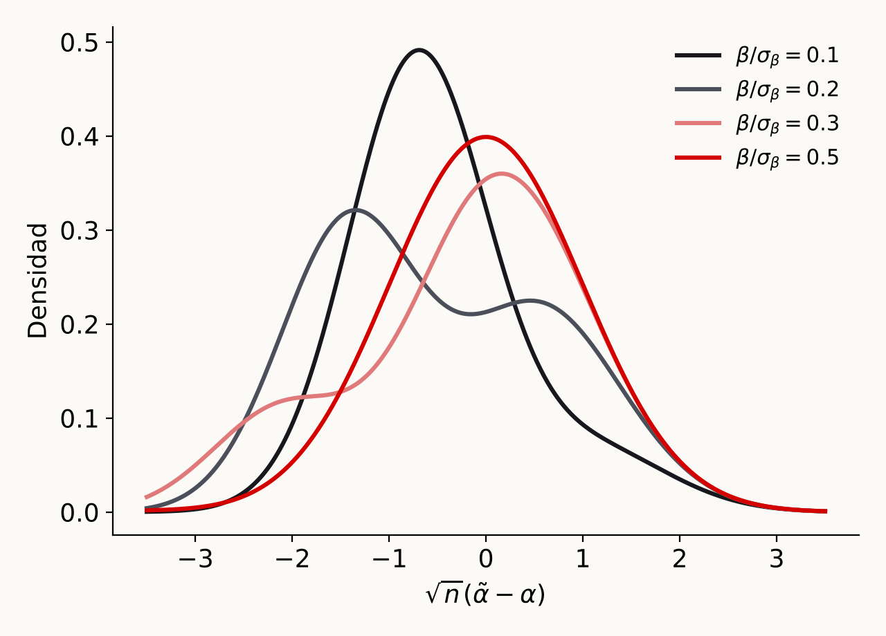

# Introducción

## Motivación
Considere el siguiente modelo

$$
Y=\alpha D+\beta'W+\epsilon
$$

- $\alpha$ es el parámetro de interés

- $W$ es un vector de variables de control

- ¿Cómo elegimos las variables del vector $W$?

## Motivación

::: {.callout-note title="Pregunta"}
Si $\alpha$ es el parámetro de interés ¿Por qué incluir $W$?
:::

- Condición de exogeneidad para inferencia causal

Una buena variable de control debe cumplir dos condiciones

1. Relevancia: predice la variable de interés
2. Confunde: está correlacionada con la variable de interés

## Motivación

Omitir una covariable que cumple las dos condiciones invalida la inferencia causal sobre $\alpha$

::: {.callout-note title="Pregunta"}
¿Qué pasa si agrego una variable que no es una variable de control?
:::

- No satisface relevancia: deteriora la precisión de la estimación

- Satifasce relevancia: mejora la precisión de la estimación

## Motivación

Dos objetivos al seleccionar $W$: condición de exogeneidad, precisión de la estimación. Dos retos a tener en cuenta

- Inferencias post-selección

- Dimensionalidad

## El problema de la inferencia post-selección {.smaller}

:::: {.columns}
::: {.column width="55%"}
**¿Qué es?** Un procedimiento en dos etapas [@gaillac2025machine, sec. 4.1]:

1. Seleccionar el modelo con los datos (p. ej., incluir $W$ solo si su estadístico $t$ es grande)
2. Reportar estimaciones, pruebas e intervalos para $\alpha$ **como si el modelo seleccionado fuera el verdadero**

::: {.fragment}
**¿Por qué es un problema?**

- La selección no es uniformemente consistente: si $\beta$ es pequeño pero distinto de cero, la regla omite $W$ con alta probabilidad $\Rightarrow$ sesgo por variable omitida
- La distribución de $\tilde\alpha$ no es normal (incluso bimodal si $D$ y $W$ están muy correlacionadas) $\Rightarrow$ pruebas e intervalos distorsionados
:::
:::
::: {.column width="45%"}
{width="100%"}

::: {style="font-size: .55em; color: #4a4f59;"}
Densidad de $\sqrt{n}(\tilde\alpha-\alpha)$ en muestra finita con $n=100$, $\rho=0.7$ y $c_n=\sqrt{\log n}$ (Lema 4.2 en @gaillac2025machine)
:::
:::
::::

# El estimador doble Lasso

## Partialling-out

$$
Y=\alpha D + \beta'W+\epsilon
$$
\alpha lo podemos obtener de la siguiente manera. Definimos $\tilde{Y}=Y-\gamma_{YW}'W$ y $\tilde{D}=D-\gamma_{DW}'W$. Es decir, la parte de la variable no explicada por $W$. Hacemos

$$
\tilde{Y}=\alpha \tilde{D}+\epsilon; \quad E[\epsilon\tilde{D}]=0
$$

## Partialling-out

::: {.callout-important title="Teorema (Frisch-Waugh-Lovell)"}
Suponga que $Y,D,W$ tienen segundos momentos finitos y que $D$ no es perfectamente predecible por $W$. El coeficiente poblacional $\alpha$ puede ser recuperado de la regresión poblacional de $\tilde{Y}$ sobre $\tilde{D}$

$$
\alpha=\underset{a}{\text{argmin}}E[(\tilde{Y}-a\tilde{D})^2]
$$
:::

## El procedimiento de doble Lasso {.smaller}

**Paso 1.** Regresiones Lasso de $Y_i$ sobre $W_i$ y de $D_i$ sobre $W_i$ [@chernozhukov2024applied, sec. 4.2]

$$
\begin{aligned}
\hat\gamma_{YW}&=\arg\min_{\gamma\in\mathbb{R}^p}\sum_i(Y_i-\gamma'W_i)^2+\lambda_1\sum_j\hat\psi_j^Y|\gamma_j|\\
\hat\gamma_{DW}&=\arg\min_{\gamma\in\mathbb{R}^p}\sum_i(D_i-\gamma'W_i)^2+\lambda_2\sum_j\hat\psi_j^D|\gamma_j|
\end{aligned}
$$

y obtener los residuales $\check Y_i=Y_i-\hat\gamma_{YW}'W_i$ y $\check D_i=D_i-\hat\gamma_{DW}'W_i$. En lugar de Lasso puede usarse Post-Lasso u otras variantes

::: {.fragment}
**Paso 2.** Regresión por MCO de $\check Y_i$ sobre $\check D_i$

$$
\hat\alpha=\arg\min_{a\in\mathbb{R}}\mathbb{E}_n[(\check Y-a\check D)^2]=\big(\mathbb{E}_n[\check D^2]\big)^{-1}\mathbb{E}_n[\check D\check Y]
$$

Se usan los resultados estándar de MCO, tratando los residuales como observados. Con $\hat\epsilon_i=\check Y_i-\hat\alpha\check D_i$, el error estándar robusto es $\sqrt{\hat V/n}$, con $\hat V=(\mathbb{E}_n[\check D^2])^{-1}\mathbb{E}_n[\check D^2\hat\epsilon^2](\mathbb{E}_n[\check D^2])^{-1}$
:::

## El procedimiento de doble Lasso {.smaller}

Dos condiciones para que el estimador funcione bien [@chernozhukov2024applied, pp. 108-109]

:::: {.columns}
::: {.column width="50%"}
::: {.tarjeta}
[1. Sparsity aproximada]{.tarjeta-titulo}

Los coeficientes ordenados de $\gamma_{YW}$ y $\gamma_{DW}$ decaen rápido, con $a>1$:
$$
|\gamma_{YW}|_{(j)}\leq Aj^{-a},\quad |\gamma_{DW}|_{(j)}\leq Aj^{-a}
$$

Se busca inferencia a tasa $\sqrt{n}$ sobre $\alpha$, no solo buena predicción: los errores de la primera etapa deben ser tan pequeños que su impacto desaparezca en la segunda. La dimensión efectiva $s\approx A^{1/a}n^{1/2a}$ crece más lento que $\sqrt{n}$
:::
:::
::: {.column width="50%"}
::: {.tarjeta .acento}
[2. Elección de $\lambda_1$ y $\lambda_2$]{.tarjeta-titulo}

Usar la regla *plug-in* (elección teórica de $\lambda$): garantiza buenas predicciones de $D$ y $Y$ sin sobreajuste. Sin esa garantía, la estimación de $\check D$ y $\check Y$ puede tener efectos de primer orden sobre $\hat\alpha$

Lasso con validación cruzada tiene propiedades teóricas similares, pero en muestras moderadas tiende a sobreajustar. Solución: *cross-fitting* (DML)
:::
:::
::::

## Neyman orthogonality {.smaller}

Parámetros de molestia: $\eta_o=(\gamma_{DW}',\gamma_{YW}')'$. Con $\tilde Y(\eta)=Y-\eta_1'W$ y $\tilde D(\eta)=D-\eta_2'W$, $\alpha(\eta)$ resuelve [@chernozhukov2024applied, sec. 4.3]

$$
M(a,\eta)=E\big[(\tilde Y(\eta)-a\tilde D(\eta))\tilde D(\eta)\big]=0
$$

::: {.callout-note title="Ortogonalidad de Neyman"}
$\alpha$ es Neyman ortogonal respecto a $\eta$ si $\partial_\eta\alpha(\eta_o)=0$. Si $\alpha$ es raíz de $M(a,\eta)=0$, la ecuación es Neyman ortogonal si $\partial_\eta M(\alpha,\eta_o)=0$
:::

::: {.fragment}
- $\alpha$ es localmente insensible a perturbaciones de $\eta$ alrededor de $\eta_o$: el sesgo de regularización de Lasso en $\hat\eta$ **no se transmite** a $\hat\alpha$, al menos a primer orden
- Selección simple (Lasso de $Y$ sobre $D$ y $W$, luego MCO) usa $M(a,b)=E[(Y-aD-b'W)D]$, con $\partial_bM(\alpha,\beta)=E[DW]\neq0$: no es ortogonal
:::

## Inferencia post-selección

¿Por qué doble Lasso soluciona el problema? [@gaillac2025machine, Remark 4.6]

- La selección se basa en **dos ecuaciones**: se eligen los controles relacionados con $D$ y los relacionados con $Y$

- Así no se omite ningún factor de confusión. El enfoque ingenuo de una sola ecuación descarta los controles con efecto pequeño sobre $Y$ pero muy correlacionados con $D$, que son justamente los que generan el sesgo

- Como resultado, el estimador de $\alpha$ tiene distribución aproximadamente normal y son válidas las pruebas de hipótesis y los intervalos de confianza usuales

## Referencias

::: {#refs}
:::
