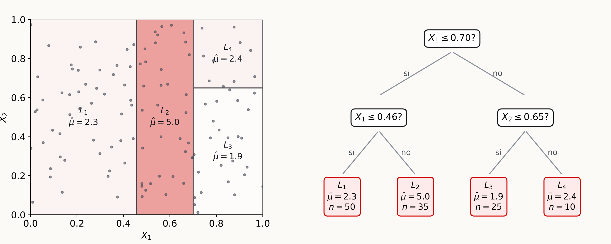
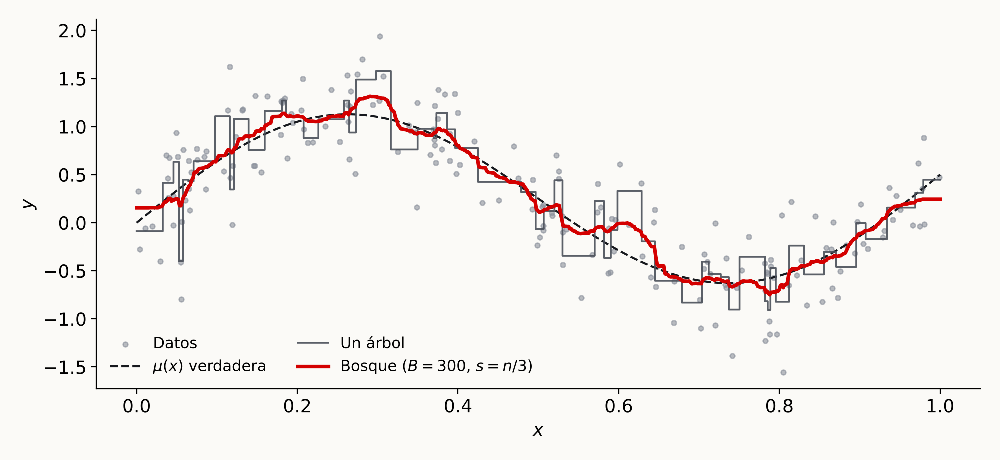

# Introducción

## Métodos de regresión no lineales

> "Nowhere is it written on a stone tablet what kind of model should be used to solve problems involving data." — Leo Breiman

Métodos basados en árboles y en redes neuronales [@chernozhukov2024applied, cap. 8]

- **Árboles de regresión**: útiles para exploración y análisis interpretable
- **Bosques aleatorios y *boosted trees***: buenas herramientas de predicción con datos estructurados y muestras de tamaño intermedio (hasta varios millones de observaciones)
- **Redes neuronales**: muy flexibles; especialmente exitosas con muestras grandes

## Objetivo: aproximar la CEF {.smaller}

Queremos predecir $Y$ con regresores $Z$ de dimensión $d$. Bajo pérdida cuadrática, la mejor regla de predicción es la función de expectativa condicional (CEF)

$$
g(Z)=E(Y\mid Z)
$$

- Hasta ahora: aproximamos $g(Z)$ con la mejor predicción **lineal** y la estimamos con MCO o Lasso
- Ahora: reglas de predicción **no lineales** para aproximar $g(Z)$, en particular métodos basados en árboles

::: {.callout-note title="¿Por qué importa para inferencia causal?"}
Identificar parámetros causales como el ATE mediante estrategias de condicionamiento requiere trabajar con CEFs, no con la mejor predicción lineal. Antes tratábamos de hacer flexible la predicción lineal; aquí exploramos estrategias totalmente no lineales
:::

# Árbol de regresión

## Árbol de regresión {.smaller}

Objetivo: estimar $\mu(x)=E[Y\mid X=x]$ con una muestra iid $(Y_i,X_i)_{i=1}^n$ mediante **particiones recursivas** [@gaillac2025machine, sec. 2.7.1]

- El árbol aproxima $\mu(x)$ con una función constante por tramos sobre una partición del espacio de $X$ definida con los datos
- La predicción es un promedio ponderado local:

$$
\hat\mu(x)=\sum_{i=1}^n\alpha_i(x)Y_i, \qquad \alpha_i(x)=\frac{1\{X_i\in L(x)\}}{|\{i:X_i\in L(x)\}|}
$$

donde $L(x)$ es la **hoja** en la que cae $x$

- Es decir, $\hat\mu(x)$ es el promedio de las $Y_i$ cuyas $X_i$ caen en la misma hoja que $x$
- Las hojas forman una partición que maximiza un criterio global de segmentación

## Cómo crece el árbol {.smaller}

Cada nodo $A$ se divide en dos nodos hijos $A_1$ y $A_2$:

a. Se escoge una variable $j\in\{1,\dots,p\}$ (según cierta distribución)
b. Se aplica un test de segmentación $X_j\geq s$, donde $s$ maximiza la heterogeneidad entre $A_1$ y $A_2$

**Algoritmo** (similar al original de @breiman2001random)

1. **Inicialización**: lista de nodos $\mathcal{A}=\{\text{raíz}\}$ y lista de hojas finales vacía
2. **Expansión**: para cada nodo $A\in\mathcal{A}$
    - Si $A$ cumple el criterio de parada (menos de $n_0$ observaciones), se retira de $\mathcal{A}$ y se agrega a las hojas finales
    - Si no, se elige una coordenada, el mejor corte $s$, y se reemplaza $A$ por sus hijos $A_1$ y $A_2$

La predicción en $x$ es el promedio de $Y_i$ en la hoja $L(x)$. Se puede agregar una etapa de poda (*pruning*), aunque no es necesaria

## Ejemplo: partición y árbol {.smaller}

{fig-align="center" width="90%"}

Cada hoja $L_m$ es un rectángulo del espacio de $(X_1,X_2)$ y su predicción es el promedio de $Y$ en ese rectángulo

## Criterio de segmentación: $Y$ binaria {.smaller}

Para clasificación se usa el criterio CART (*Classification and Regression Tree*): escoger $s$ para maximizar la **ganancia de homogeneidad** [@gaillac2025machine, sec. 2.7.2]

$$
I(A_1,A_2)=G(A)-qG(A_1)-(1-q)G(A_2), \qquad q=\frac{N_{A_1}}{N_A}
$$

donde $G(A)$ es el **índice de Gini**, una medida de (falta de) homogeneidad del nodo

$$
G(A)=1-\bar Y_A^2-(1-\bar Y_A)^2
$$

- $\bar Y_A$ es la proporción de unos en el nodo $A$
- $G(A)=0$ si $\bar Y_A=0$ o $\bar Y_A=1$: el nodo es perfectamente homogéneo
- Un buen corte genera dos hijos **heterogéneos entre sí**, cada uno con observaciones **homogéneas**

## Criterio de segmentación: regresión {.smaller}

Con $Y$ continua se usa una estructura similar: se maximiza la **reducción de la varianza**

$$
I(A_1,A_2)=E(A)-\big(qE(A_1)+(1-q)E(A_2)\big)
$$

donde

$$
E(A)=\frac{1}{N_A}\sum_{i:X_i\in A}(Y_i-\bar Y_A)^2
$$

es la varianza de $Y$ dentro del nodo $A$

- $E(A)$ no depende del corte, así que maximizar $I(A_1,A_2)$ equivale a **minimizar** $qE(A_1)+(1-q)E(A_2)$
- Se busca, entre todas las variables y cortes posibles, la partición que más reduce la varianza ponderada de los hijos

# Bosque aleatorio

## Bosque aleatorio

Un solo árbol es muy inestable (alta varianza). El bosque aleatorio **agrega** árboles construidos sobre submuestras de tamaño $s$ [@gaillac2025machine, sec. 2.7.3]

$$
\hat\mu(x;U_1,\dots,U_n)=\binom{n}{s}^{-1}\sum_{1\leq i_1<\dots<i_s\leq n}T(x;U_{i_1},\dots,U_{i_s})
$$

- $U_i=(Y_i,X_i)$ y $T(x;\cdot)$ es la predicción de un árbol construido con esa submuestra
- Se promedia sobre **todas** las $\binom{n}{s}$ submuestras posibles de tamaño $s$
- Cada árbol es aleatorio: en cada nodo la variable de corte se escoge al azar

## Bosque aleatorio en la práctica {.smaller}

Promediar sobre todas las submuestras es inviable, así que se aproxima por Monte Carlo: se extraen $B$ submuestras **sin reemplazo** $\mathcal{S}_b$, $b=1,\dots,B$, de tamaño $s$

$$
\hat\mu(x;U_1,\dots,U_n)\approx\frac{1}{B}\sum_{b=1}^BT(x;U^*_{b,1},\dots,U^*_{b,s})
$$

y cada árbol predice con el promedio de su hoja

$$
T(x;U^*_{b,1},\dots,U^*_{b,s})=\sum_{i\in\mathcal{S}_b}\alpha^*_{b,i}(x)Y^*_{b,i}, \qquad \alpha^*_{b,i}(x)=\frac{1\{X^*_{b,i}\in L^*_b(x)\}}{|\{i:X^*_{b,i}\in L^*_b(x)\}|}
$$

::: {.callout-note title="Bagging"}
Esta estrategia de agregación se conoce como *bagging* y **reduce la varianza** del estimador de $\mu$
:::

## Un árbol vs. un bosque {.smaller}

{fig-align="center" width="82%"}

Un árbol profundo sigue el ruido de los datos; el promedio de $B$ árboles construidos en submuestras es mucho más estable

## Referencias

::: {#refs}
:::
